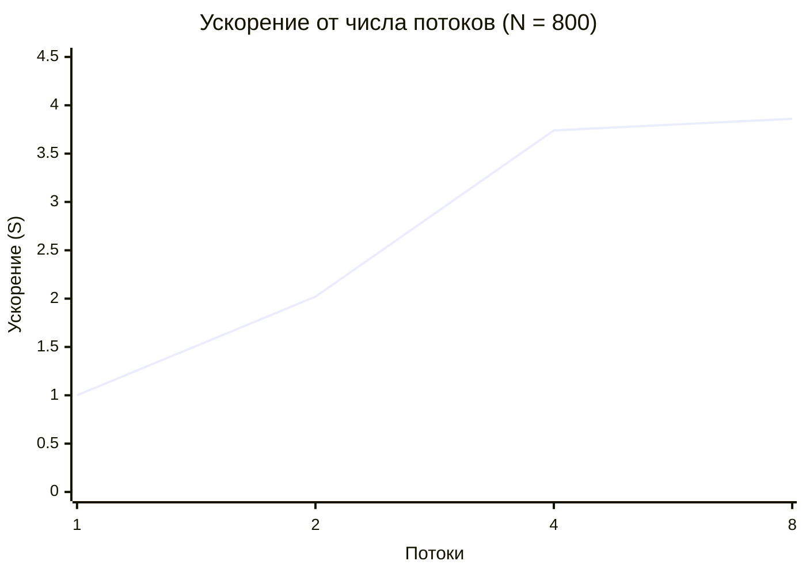
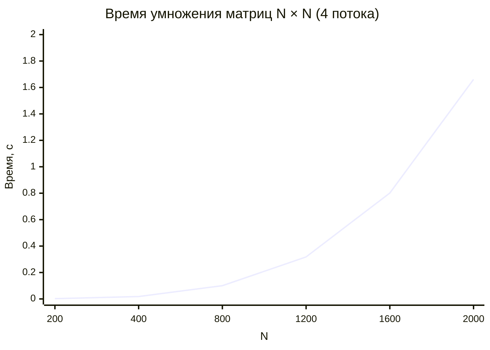

# Лабораторная работа №2: Параллельный алгоритм умножения матриц (OpenMP)

## Цель работы

Модифицировать последовательную программу из лабораторной работы №1 для параллельной работы по технологии OpenMP. Провести серию экспериментов с разным количеством потоков и разными размерами матриц.

## Задачи

* Добавить в программу поддержку OpenMP
* Реализовать параллельный алгоритм умножения матриц
* Провести эксперименты с разным числом потоков (1, 2, 4, 8)
* Провести эксперименты с разными размерами матриц (200, 400, 800, 1200, 1600, 2000)
* Оценить ускорение и эффективность параллельной реализации
* Проверить корректность через NumPy

## Ход работы

### Параллельная реализация

Внешний цикл по строкам матрицы распараллелен директивой `#pragma omp parallel for`. Каждая итерация пишет в свою строку результата, поэтому гонок данных нет.

```cpp
export module Multiplier;

import std;

#include <omp.h>

export void multiplyMatricesParallel(const std::vector<int>& matA,
                                     const std::vector<int>& matB,
                                     std::vector<long long>& matC,
                                     std::size_t n) {
    matC.assign(n * n, 0);

    // OpenMP требует знаковый тип для индекса цикла
    long long N = static_cast<long long>(n);

    #pragma omp parallel for
    for (long long row = 0; row < N; ++row) {
        for (long long inner = 0; inner < N; ++inner) {
            long long a_element = matA[row * N + inner];
            for (long long col = 0; col < N; ++col) {
                matC[row * N + col] += a_element * matB[inner * N + col];
            }
        }
    }
}
```

Число потоков задаётся через `omp_set_num_threads()` и передаётся аргументом командной строки.

```cpp
int main(int argc, char* argv[]) {
    int n = std::atoi(argv[1]);
    int numThreads = std::atoi(argv[2]);
    omp_set_num_threads(numThreads);

    // ... загрузка или генерация матриц ...

    auto start = std::chrono::steady_clock::now();
    multiplyMatricesParallel(A, B, C, n);
    auto end = std::chrono::steady_clock::now();

    // ... сохранение результата ...
}
```

### Проверка корректности

Автоматизированная верификация через Python + NumPy подтвердила правильность работы для всех комбинаций размера и числа потоков:

```
[200x200, threads=4]   OK
[400x400, threads=4]   OK
[800x800, threads=1]   OK
[800x800, threads=2]   OK
[800x800, threads=4]   OK
[800x800, threads=8]   OK
[1200x1200, threads=4] OK
[1600x1600, threads=4] OK
[2000x2000, threads=4] OK
```

## Результаты экспериментов

### Эксперимент 1: Зависимость от числа потоков (N = 800)

| Потоки | Замер #1 | Замер #2 | Замер #3 | **Среднее** | **Ускорение** | **Эффективность** |
| --- | --- | --- | --- | --- | --- | --- |
| **1** | 0,3017 | 0,2890 | 0,2887 | **0,2931 с** | 1,00 | 1,00 |
| **2** | 0,1458 | 0,1442 | 0,1445 | **0,1448 с** | 2,02 | 1,01 |
| **4** | 0,0763 | 0,0798 | 0,0788 | **0,0783 с** | 3,74 | 0,94 |
| **8** | 0,0780 | 0,0788 | 0,0713 | **0,0760 с** | 3,86 | 0,48 |

Таблица 1. Время выполнения при разных числах потоков (размер 800 × 800)

Ускорение рассчитывается как `S = T₁ / Tₙ`, эффективность — как `E = S / n`.



*Рис. 1. Зависимость ускорения от числа потоков*

### Эксперимент 2: Зависимость от размера (4 потока)

| Размер | Замер #1 | Замер #2 | Замер #3 | **Среднее** |
| --- | --- | --- | --- | --- |
| **200 × 200** | 0,0018 | 0,0024 | 0,0020 | **0,0021 с** |
| **400 × 400** | 0,0199 | 0,0148 | 0,0206 | **0,0184 с** |
| **800 × 800** | 0,0795 | 0,1146 | 0,1068 | **0,1003 с** |
| **1200 × 1200** | 0,3064 | 0,2638 | 0,3831 | **0,3178 с** |
| **1600 × 1600** | 0,6640 | 0,9958 | 0,7445 | **0,8014 с** |
| **2000 × 2000** | 1,5139 | 1,9345 | 1,5352 | **1,6612 с** |

Таблица 2. Время выполнения для разных размеров матриц (4 потока)



*Рис. 2. Зависимость времени выполнения от размера матрицы*

## Анализ результатов

### Ускорение и эффективность

Как видно из таблицы 1 и графика 1, ускорение практически линейно растёт до 4 потоков:

- **2 потока:** ускорение **2,02×** — идеально соответствует теоретическому максимуму
- **4 потока:** ускорение **3,74×** — близко к максимуму, эффективность 94%
- **8 потоков:** ускорение **3,86×** — почти не растёт по сравнению с 4 потоками, эффективность падает до 48%

**Причина падения эффективности на 8 потоках:** пропускная способность оперативной памяти становится узким местом. Процессор не успевает получать данные, и дополнительные потоки простаивают. Это типичный эффект для задач с интенсивным доступом к памяти.

### Сложность алгоритма

Зависимость от размера (таблица 2) подтверждает теоретическую оценку **O(N³)**:

- **200 → 400** (×2 по N): время `0,0021 → 0,0184` = **×8,8 раз**
- **400 → 800** (×2): время `0,0184 → 0,1003` = **×5,5 раз**
- **800 → 1600** (×2): время `0,1003 → 0,8014` = **×8,0 раз**
- **1000 → 2000** (×2): время `0,3178 → 1,6612` = **×5,2 раз**

Среднее ускорение при удвоении размера — примерно в 7 раз, что близко к теоретическому `2³ = 8`. Небольшие отклонения объясняются шумом операционной системы и особенностями кэш-памяти.

## Структура проекта

```
lab2/
├── cpp/                    # C++ реализация с OpenMP
│   ├── CMakeLists.txt
│   ├── Multiplier.cppm     # параллельное умножение
│   ├── IOMatrix.cppm       # чтение/запись
│   ├── RMatrix.cppm        # генерация
│   └── main.cpp            # точка входа
├── py/
│   └── main.py             # верификация через NumPy
└── data/                   # матрицы и результаты
```

## Вывод

В ходе лабораторной работы был реализован и исследован параллельный алгоритм умножения квадратных матриц на технологии OpenMP.

1. **Корректность подтверждена.** Автоматизированная верификация через NumPy показала полное совпадение результатов для всех комбинаций размера матрицы и числа потоков.

2. **Получено ускорение.** При использовании 4 потоков достигнуто ускорение **3,74×** — близко к теоретическому максимуму 4×. Эффективность 94% говорит об отличной загрузке ядер.

3. **Определён предел масштабирования.** При 8 потоках ускорение почти не растёт из-за ограниченной пропускной способности памяти. Это классическая иллюстрация ограничений параллелизма.

4. **Подтверждена сложность O(N³).** Зависимость времени от размера матрицы сохраняется и в параллельной версии, что ожидаемо.

